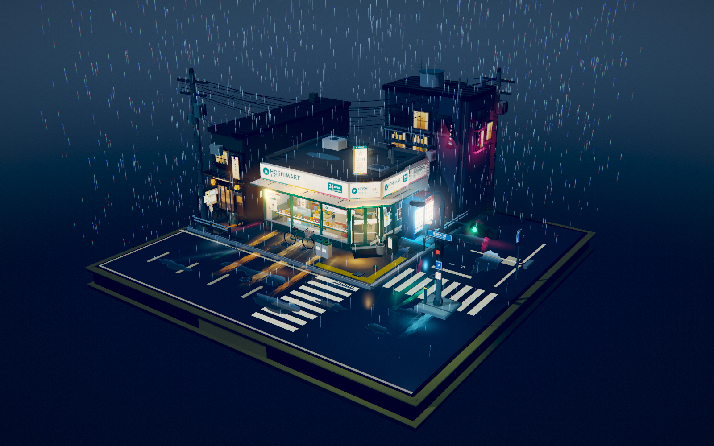
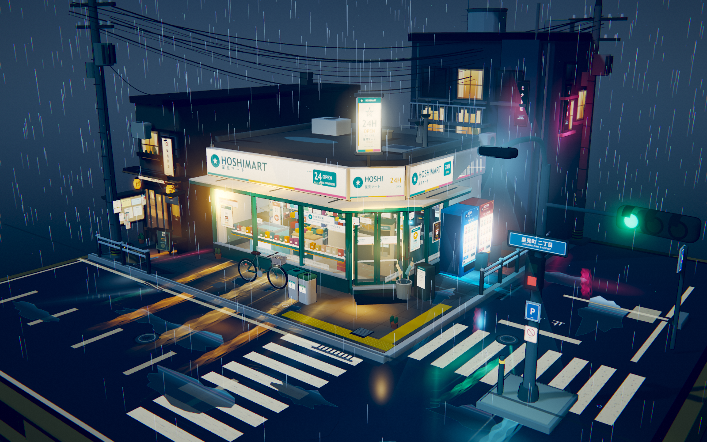
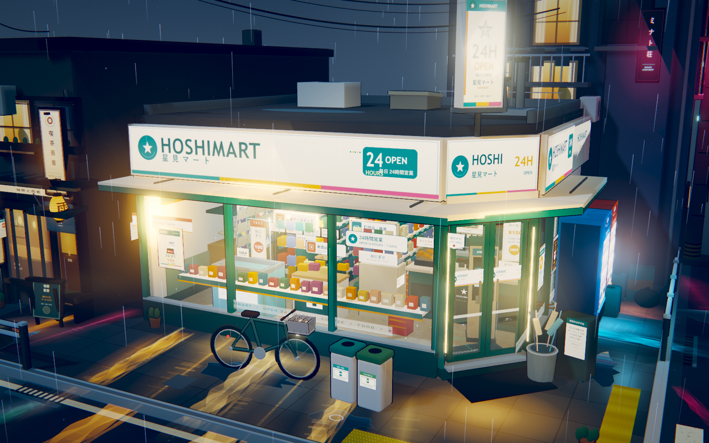

# 雨夜便利店街角 / HOSHIMART

一个可自由旋转、缩放观看的日式雨夜便利店微缩街角。整个场景使用 Three.js（WebGL）实时渲染，未使用 Blender，也不依赖任何外部模型或贴图文件。

## 场景预览

### 默认全景 · 完整正方形底座

### 街角店面 · 霓虹与反光

### 橱窗与店内陈设

> 点击图片可查看原始尺寸。

## 打开

直接双击 `index.html`。所有代码、材质、字体绘制的招牌与海报都已内联在这一份文件里，不需要启动服务器，也不需要联网。

## 交互

- 鼠标左键拖拽：旋转视角
- 鼠标滚轮：拉近 / 拉远
- 触屏：单指拖动旋转，双指捏合缩放
- 页面没有按钮、标题、说明文字或其他 UI 覆盖层

## 场景特点

- 完整正方形底座、可以绕场自由观看的微缩模型构图
- 便利店、街道转角、十字路口、斑马线、街角护栏、停车位、排水沟、积水路面
- 自动贩卖机、自行车、雨伞架、垃圾桶、路灯、电线杆和下垂电线、路牌、公告栏
- 大玻璃橱窗、自动滑门、雨棚及檐口滴水
- 可通过大面积玻璃看到店内：货架、饮料冷柜、便当与饭团、杂志架、收银台、关东煮、咖啡机、店内灯箱、后场门等
- 三渲二材质、分层卡通明暗、合并的墨线轮廓
- 持续降雨、地面水花与积水涟漪、沿玻璃滑落的水珠、檐口滴水、店内热食蒸汽
- 招牌轻微闪烁、自动门偶发开合、交通灯缓慢轮换、路面积水反射灯光
- 湿地面上的暖色与冷色反光、霓虹层次、冷暖对比

## 结构

- [PROMPT.md](PROMPT.md) — 本项目原始提示词
- `index.html` — 最终可独立打开的作品（脚本已内联）
- `src/` — 场景源码
- `index.template.html` — 页面模板
- `build.mjs` — 使用本地 esbuild 构建单文件版本
- `preview.png` — 默认视角预览
- `preview-closeup.png` — 店面近景预览
- `preview-interior.png` — 店面与橱窗细节预览
